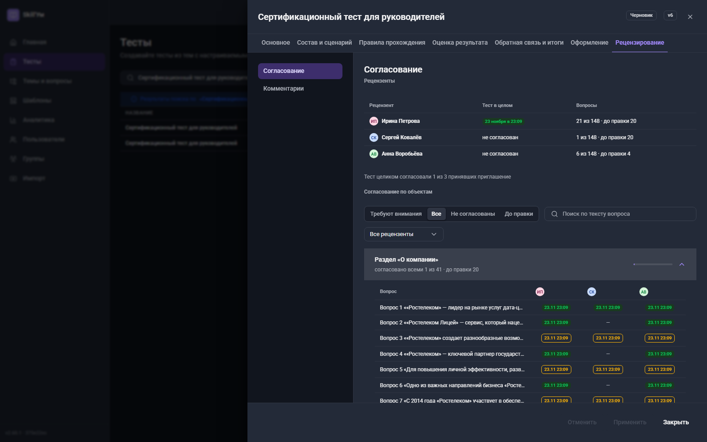
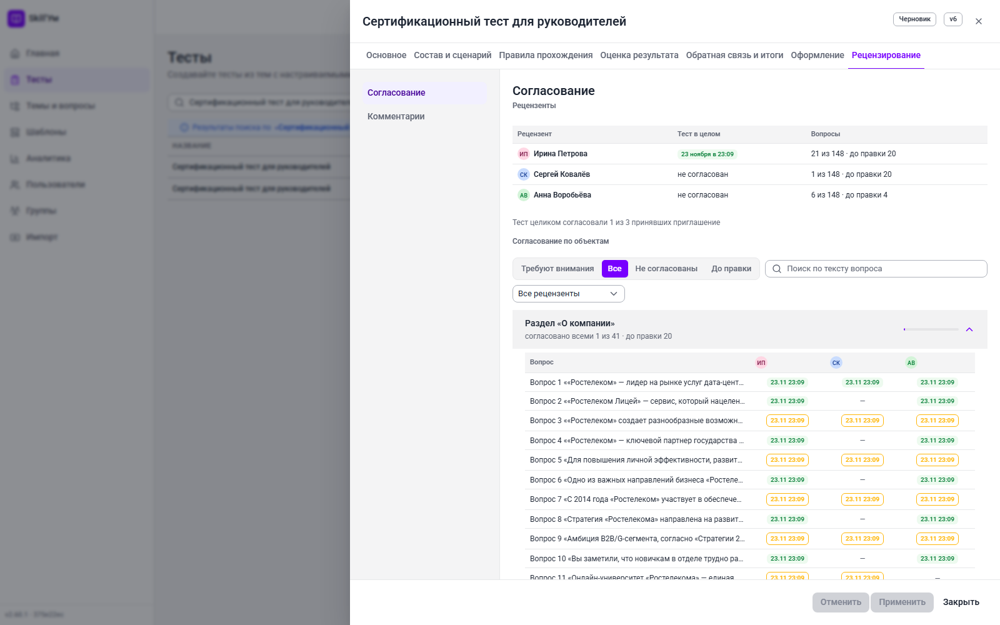
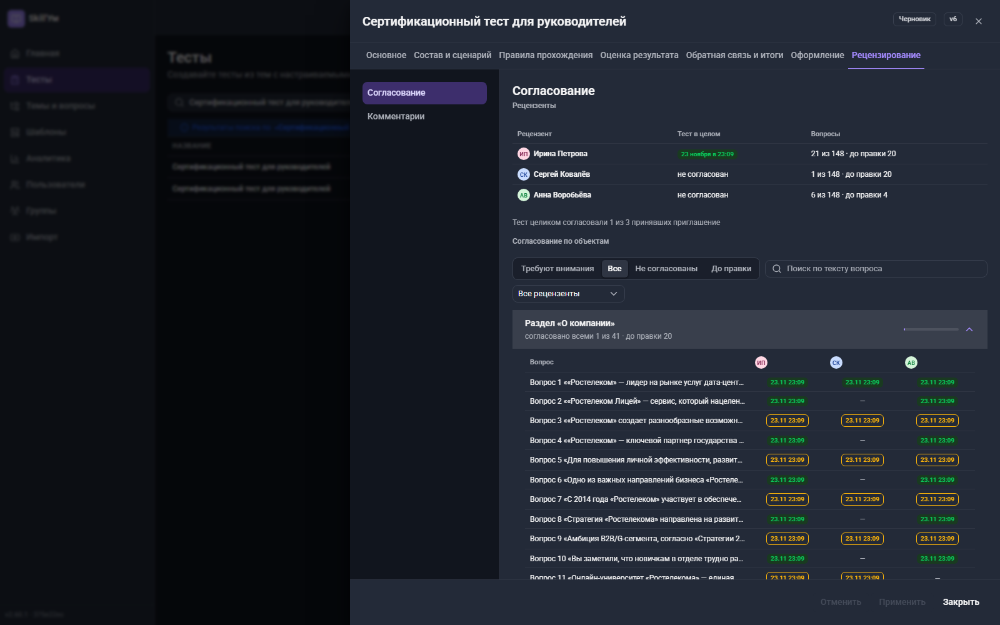
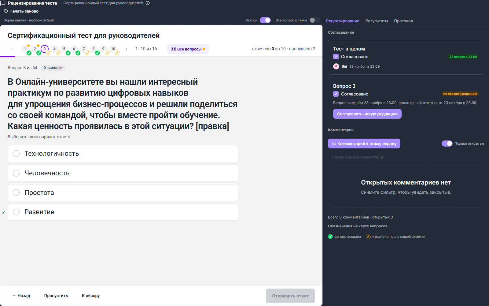
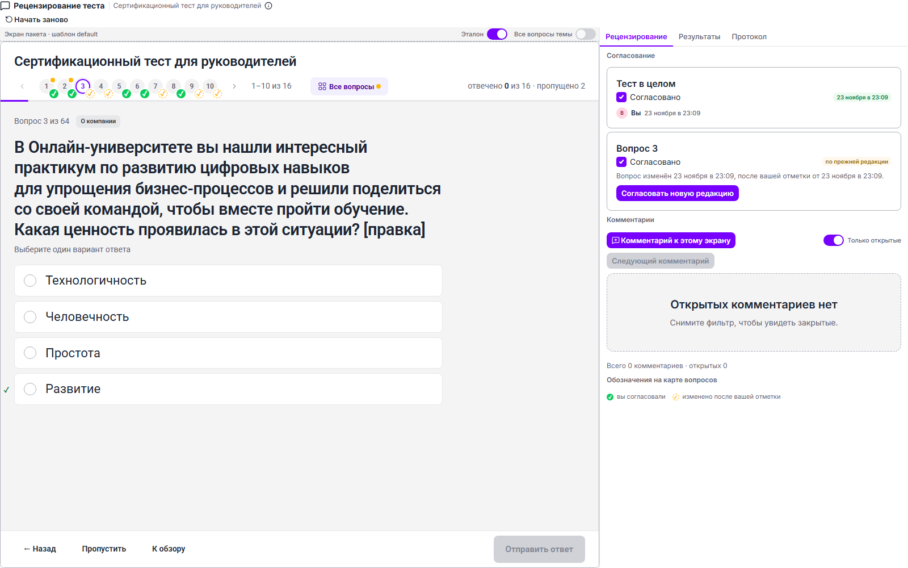
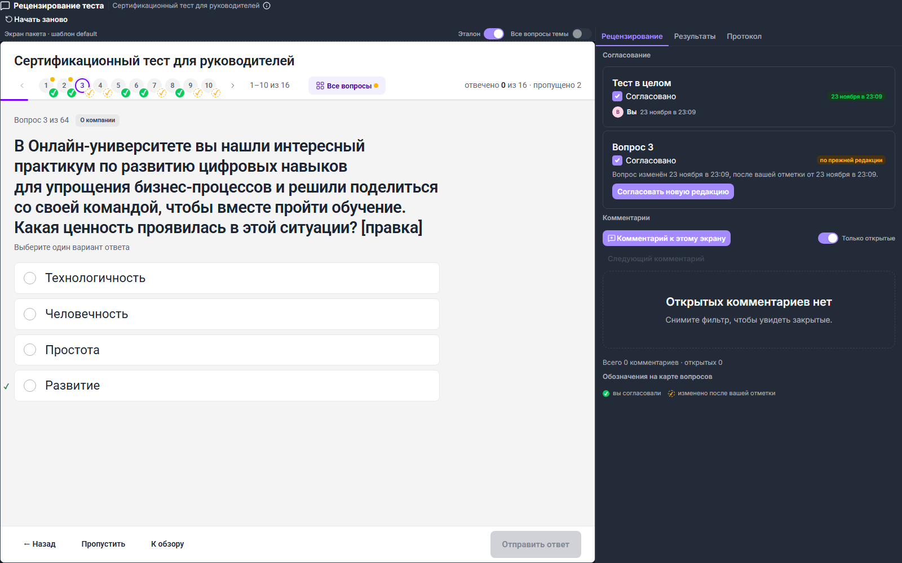
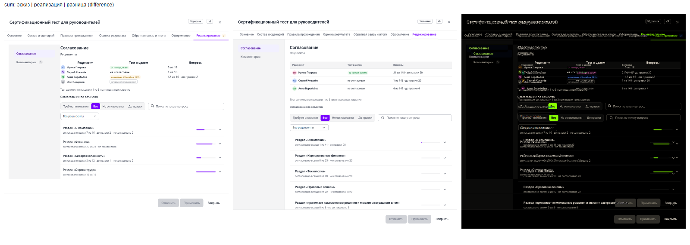
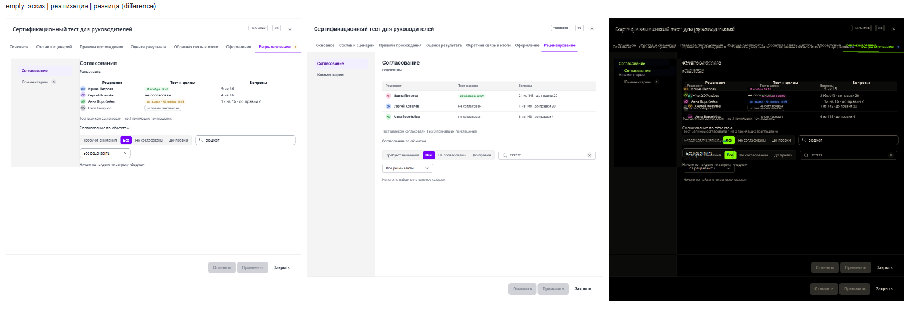
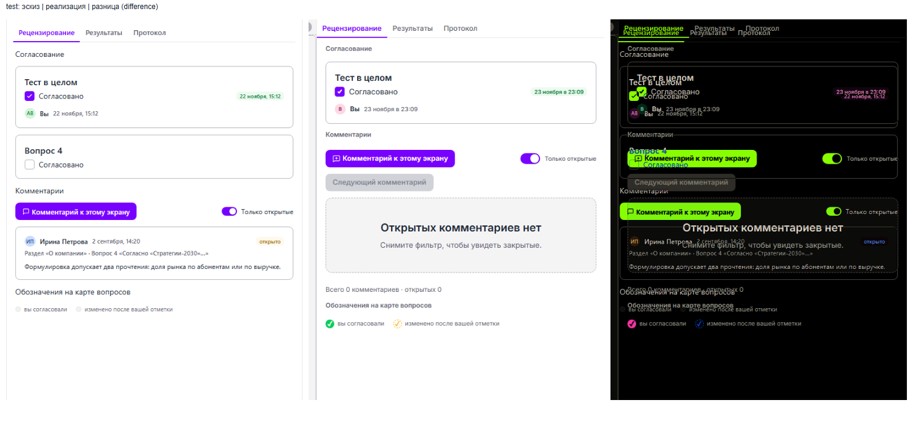
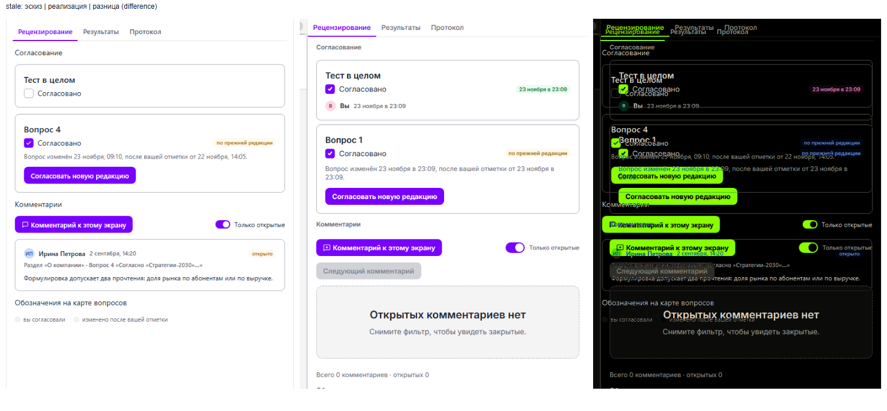

# Приёмка флага «Согласовано» в браузере: 2026-11-23

Что принималось: [спека](../specs/2026-11-23-review-approval-flag-design.md), эскиз
[prd52-review-approval.html](../wireframes/approved/prd52-review-approval.html), план
[2026-11-23-review-approval-flag.md](../plans/2026-11-23-review-approval-flag.md), задача 12.

Стенд: dev-сервер из worktree `feat/review-approval` на порту 8123, общая dev-БД (миграция `0067` применена),
headless Chromium через собственный CDP-драйвер (Playwright-MCP в сессии занят чужим процессом). Тест
«Сертификационный тест для руководителей»: 8 разделов, 148 вопросов в банке. Заведены учётки автора
(`acceptance@local.test`) и двух рецензентов с грантом `review` (роль learner). Данные приёмки после неё удалены.

## Что проверено

| Проверка | Результат |
| --- | --- |
| API на живом сервере: приватность отметок, права, идемпотентность, снятие, принятие приглашения (15 проверок) | Пройдено |
| Окно рецензента, рецензент 1: блок «Согласование», чекбоксы, дата и время, строка «Вы» | Пройдено |
| Клик по чекбоксу текущего вопроса ставит отметку, на точке карты появляется бейдж | Пройдено после исправления 1 |
| Панель «Все вопросы»: те же бейджи на точках размера `l`, легенда из двух строк | Пройдено |
| Окно рецензента, рецензент 2: чужих отметок нет ни в карточках, ни на карте, ни в ответе API | Пройдено |
| Вкладка «Рецензирование» редактора: рейл, таблица рецензентов, сводка по разделам, фильтр, матрица | Пройдено |
| Фильтр «Все», раскрытие раздела, пустой результат поиска, рейл «Комментарии» | Пройдено |
| Отметка до правки (хеш подменён в БД): «до правки 1» в сводке и таблице, пунктирный бейдж у рецензента | Пройдено |
| Окно отладки автора: бейдж круга рецензентов, легенда из трёх строк, счётчик «согласовали N из M» | Пройдено |
| Границы окна: 1920x1000, 1440x800, 1100x700, 900x700 - нет обрезки и горизонтальной прокрутки | Пройдено |
| Токены `--ou-*` в iframe пакета: бейдж получает цвет и размер | Пройдено |
| `accepted_at` у обоих рецензентов заполнен после первого обращения | Пройдено |

## Найдено и исправлено при приёмке

1. Бейджи не появлялись на точках. Элемент порядка выдачи в живом состоянии пакета (`flatQuestions[i]`) имеет вид
   `{ question: { id, ... }, ... }`, а хук читал `q.id`. Юнит-тест подставлял выдуманную раскладку `{ id }` и
   проходил. Исправлены хук и фикстура теста: теперь повторяют раскладку пакета.
2. На вкладке редактора не было заголовка раздела над содержимым («Согласование» и «Комментарии»), как в эскизе.
   Содержимое обёрнуто в `FormSection` с заголовком над содержимым.

## Расхождения с эскизом, оставленные осознанно или открытые

| Что | Состояние |
| --- | --- |
| Формат даты: эскиз пишет «21 ноября, 18:40», Chromium в локали `ru-RU` даёт «23 ноября в 21:49» | Тот же форматтер, что у ленты комментариев; эскиз содержит набранный руками текст. Решение: оставить |
| Заголовок карточки текущего вопроса: эскиз «Вопрос 4», реализация «Текущий вопрос» | Закрыто: «Вопрос N» (issue 60), на стартовом экране карточки вопроса нет (issue 65) |
| Строка про правку: эскиз называет время изменения вопроса | Закрыто: поле `changedAt`, колонка `questions.content_changed_at` (issue 61) |
| Подсказка точки у автора со списком согласовавших | Закрыто: подсказка в окне отладки автора (issue 62) |
| Порог карты вопросов в шаблоне (520 или 640 пикселей) | Закрыто: 700 пикселей, узкая страница резервирует ширину 5 точек (issue 63); на 521-539 пикселях кнопка «Все вопросы» по-прежнему переносится, решение владельца |
| Ширины столбцов таблицы рецензентов: в реализации первый столбец шире | Косметика, не меняет смысла; см. issue 67 |

## Дополнительная приёмка: тёмная тема, Compact, наложение кадров, письмо и ссылка (issue 64)

Стенд: dev-сервер на порту 8099 из `main` (коммит `375e22ec`), общая dev-БД, headless Chromium через CDP, данные
те же: «Сертификационный тест для руководителей». Для приёмки заведены три рецензента с грантом `review`, у них
отметки на все 41 вопросов темы «О компании» и тест целиком, у 20 вопросов формулировка временно изменена
(устаревшие отметки). Данные после приёмки возвращены: формулировки восстановлены, отметки и гранты сняты, учётки
деактивированы.

### Тёмная тема и режим Compact

Тема переключалась классом `ou--dark` на `body`, плотность классом `ou--compact`, в кадре пакета тема
эмулировалась через `prefers-color-scheme`. Каждый вид снят в четырёх сочетаниях (светлая и тёмная тема, обычная
плотность и Compact): вкладка «Рецензирование» редактора в состояниях «требуют внимания», «все разделы» и
«ничего не найдено» и окно рецензента с устаревшей отметкой.

| Проверка | Результат |
| --- | --- |
| Вкладка «Рецензирование» редактора в четырёх сочетаниях: рейл, таблица рецензентов, фильтр, сводка, матрица | Пройдено: горизонтальной прокрутки и обрезки нет, контраст бейджей в матрице достаточный |
| Окно рецензента в четырёх сочетаниях: карточки, строка «изменён ... после вашей отметки», бейджи и легенда на карте | Пройдено: перенос и обрезки нет, бейджи на точках читаются на светлом кадре пакета |
| Подсказка точки у автора в тёмной теме и Compact | Пройдено: подсказка читается; при длинном имени тег «не согласовал» переносится (issue 67) |
| Кадр пакета в тёмной теме | Остаётся светлым: тему кадра задаёт шаблон оформления теста, а не окно рецензирования |

### Наложение кадров эскиза и реализации

Эскиз открывался в браузере в том же размере окна, что реализация (1600 пикселей по ширине для редактора, ширина
панели рецензирования 543 пикселя для окна рецензента). Три кадра рядом: эскиз, реализация и их разность
(`mix-blend-mode: difference`). Данные в эскизе и в реализации разные (16 вопросов против 148, другие имена), поэтому
сравнивалась раскладка, а не текст.

| Состояние | Результат |
| --- | --- |
| Редактор, «все разделы» (`sum`) | Раскладка совпадает: рейл, таблица рецензентов, фильтр, поиск, выбор рецензента, список разделов |
| Редактор, «ничего не найдено» (`empty`) | Совпадает, текст «Ничего не найдено по запросу» на том же месте |
| Окно рецензента, «тест целиком» (`test`) | Совпадает: две карточки по эскизу при том, что на стартовом экране в реализации вторая карточка скрыта (issue 65, осознанное расхождение) |
| Окно рецензента, «объект изменён» (`stale`) | Совпадает: тег «по прежней редакции», строка со временем правки, кнопка «Согласовать новую редакцию» |

Найденные мелкие расхождения заведены одним issue 67: подписи разделов в окне рецензента (в эскизе обычный текст,
в реализации мелкая жирная подпись), лишняя кнопка «Следующий комментарий» из ленты комментариев, выравнивание
столбцов таблицы рецензентов и серая шапка таблицы, перенос тега в подсказке при длинном имени.

### Приглашение письмом и вход по персональной ссылке

Приглашение отправлено на ящик продукта `skillum@yandex.com` (учётка с этим адресом уже была в БД, участник
внешний, роль `learner`): `POST /api/tests/:id/review/invite` с `sendEmail: true`, ответ `delivered: true`. Текст
письма из ящика не читался, ссылка взята из поля `magicLink` ответа.

| Проверка | Результат |
| --- | --- |
| Письмо уходит, `delivered: true` | Пройдено |
| До открытия окна в круге автора рецензент с `accepted: false` | Пройдено |
| Ссылка `/access/<token>` в чистом браузере: сессия открывается, `GET /api/auth/me` отдаёт `learner` и границу `purpose: review`, переход на `/review/tests/:id` | Пройдено |
| `accepted_at` проставляется при первом обращении к окну (`accepted: true` у автора) | Пройдено |
| Работа в окне по ссылке: `POST /review/session` и `GET /review/comments` отвечают 200 | Пройдено |
| `GET` и `PUT /review/approvals` по ссылке | Не пройдено: 403 `MAGIC_SCOPE`, окно уводит на форму входа (issue 66) |

Найден дефект: маршруты отметок не внесены в список `MAGIC_SCOPE_RULES`, поэтому внешний рецензент по ссылке из
письма не может работать в окне. Заведён issue 66 с воспроизведением и предложением правки. После правки нужно
повторить проверку отметки и её снятия под внешним рецензентом: до этого момента эта часть приёмки не закрыта.

## Не проверялось

- Отметка, её снятие и бейджи под внешним рецензентом по ссылке: блокирует issue 66.
- Номер вопроса в адаптивном тесте на втором и последующих вопросах (правило «отвечено плюс 1» проверено только
  на первом).
